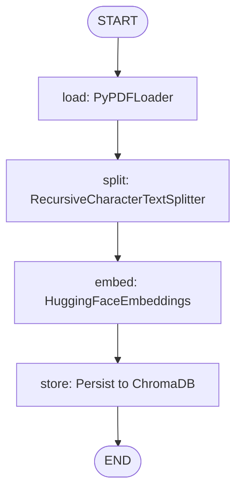

# PDF Vectorisation Pipeline
> **Nestack Technical Assessment &bull; LangChain &amp; LangGraph Implementation**

[](https://www.python.org/downloads/)
[](https://github.com/langchain-ai/langchain)
[](https://github.com/langchain-ai/langgraph)
[](https://docs.trychroma.com/)
[](https://fastapi.tiangolo.com/)

---

## 1. Project Overview

This project implements a modular PDF Vectorisation Pipeline adhering to the Nestack technical assessment specification. The architecture strictly decouples document ingestion from runtime retrieval:

1. **PDF Ingestion Pipeline (`ingest.py`)**: Modeled as an explicit deterministic state graph using **LangGraph** (`load` &rarr; `split` &rarr; `embed` &rarr; `store`). It parses multi-page PDFs, chunks text while strictly preserving 1-indexed page numbers, generates dense semantic embeddings using Hugging Face's `all-MiniLM-L6-v2`, and persists vectors to disk using ChromaDB. **A new ingestion intentionally resets and clears the previous collection to guarantee clean indexing without stale duplicates.**
2. **Direct Vector Retrieval HTTP API (`server.py`)**: A focused FastAPI service exposing `POST /query` that performs vector search directly via `similarity_search_with_score()`. **Strictly NO LLM calls, NO answer generation, NO QA chains, and NO conversational wrappers are used.** Evaluators retrieve raw source passages, source page numbers, and similarity distance scores directly.

---

## 2. Architecture

```
[CLI DOCUMENT INGESTION WORKFLOW]
PDF Document (e.g., data/Anwith_Major_Project_Report.pdf)
    │
    ▼
[Node: load]  ──> PyPDFLoader (Pure Python, extracts page text & metadata)
    │
    ▼
[Node: split] ──> RecursiveCharacterTextSplitter (800 chars, 150 overlap)
    │
    ▼
[Node: embed] ──> HuggingFaceEmbeddings (all-MiniLM-L6-v2, 384-dim dense vectors)
    │
    ▼
[Node: store] ──> ChromaDB (Resets collection & persists to ./vectorstore)

─────────────────────────────────────────────────────────────────────────

[DIRECT RETRIEVAL HTTP API]
HTTP POST /query {"query": "...", "top_k": 3}
    │
    ▼
Embed incoming query via the shared HuggingFaceEmbeddings model
    │
    ▼
vectorstore.similarity_search_with_score(query, k=top_k)
    │
    ▼
Extract 1-indexed page_number metadata & format raw scores
    │
    ▼
Return raw JSON array: [{"chunk_text": "...", "page_number": int, "score": float}]
```

---

## 3. Technologies Used

- **Language**: Python 3.11+
- **Pipeline Orchestration**: LangGraph (`StateGraph`)
- **Document Loading**: LangChain `PyPDFLoader` (`pypdf`)
- **Text Splitting**: LangChain `RecursiveCharacterTextSplitter`
- **Embedding Integration**: LangChain `HuggingFaceEmbeddings` (`sentence-transformers/all-MiniLM-L6-v2`)
- **Vector Store**: `Chroma` (Local persistent storage with HNSW index)
- **HTTP Server**: FastAPI & Uvicorn
- **Testing**: PyTest & FastAPI TestClient

---

## 4. Installation & Setup

### Step 1: Clone Repository
```bash
git clone https://github.com/<your-username>/Anwith_Nestack_Submission.git
cd Anwith_Nestack_Submission
```

### Step 2: Virtual Environment Setup
```bash
# Windows (PowerShell)
python -m venv venv
.\venv\Scripts\Activate.ps1

# Linux / macOS
python3 -m venv venv
source venv/bin/activate
```

### Step 3: Install Dependencies
```bash
pip install -r requirements.txt
```

---

## 5. How to Run Ingestion

PDF ingestion is intentionally performed via the command-line interface (`ingest.py`) prior to starting the retrieval server.

### Run Ingestion on the Submission PDF
```bash
python ingest.py --file data/Anwith_Major_Project_Report.pdf
```

### Testing Another PDF
```bash
python ingest.py --file path/to/your/document.pdf
```

> **Vector Store Lifecycle Note**: Each execution of `ingest.py` automatically deletes the previous `pdf_documents` Chroma collection and rebuilds it from scratch with deterministic chunk IDs. This ensures zero stale or duplicate chunks across successive ingestion runs.

### Sample Queries for the Included PDF

The repository includes a sample PDF at:

`data/Anwith_Major_Project_Report.pdf`

The following queries can be used to verify the retrieval endpoint against the included sample PDF:

1. What is the main objective of the proposed traffic violation detection system?
2. What are the four classes detected by the YOLOv8l model?
3. How many images are included in the dataset?
4. What are the training, validation, and testing splits?
5. What technologies were used to develop the system?

These are example test queries. Evaluators may also test the pipeline with their own PDF documents by running the ingestion script with the desired PDF path:

```bash
python ingest.py --file path/to/your/document.pdf
```

### Ingestion Output Example:
```
================================================================
  PDF VECTORISATION PIPELINE - INGESTION
================================================================
Target Document   : C:\File Manager\Anwith_Nestack_Submission\data\Anwith_Major_Project_Report.pdf
File Size         : 2,244,066 bytes
Chunk Size        : 800
Chunk Overlap     : 150
Vector Store Path : C:\File Manager\Anwith_Nestack_Submission\vectorstore
LangGraph Nodes   : [START] -> load -> split -> embed -> store -> [END]
----------------------------------------------------------------
  [load]  Loaded 60 page(s) from 'Anwith_Major_Project_Report.pdf' via PyPDFLoader.
  [load]  First page character count: 514
  [load]  Last page character count: 189
  [split] Created 143 chunk(s) from 60 page(s) (size=800, overlap=150).
  [split] Chunks per page summary: 60 unique pages, average 2.38 chunks/page.
  [embed] Initialized 'sentence-transformers/all-MiniLM-L6-v2' embedding integration.
  [store] Cleared previous collection 'pdf_documents' to prevent stale vectors.
  [store] Successfully persisted 143 vectors to disk at 'vectorstore'.
----------------------------------------------------------------
SUCCESS: Ingestion completed in 10.01 seconds.
Pages Processed : 60
Chunks Indexed  : 143
Vector Store    : C:\File Manager\Anwith_Nestack_Submission\vectorstore
================================================================
```

*Optional CLI arguments:*
- `--file`, `-f`: Path to the PDF file (default: looks for `data/Anwith_Major_Project_Report.pdf`)
- `--chunk-size`: Chunk size in characters (default: `800`)
- `--chunk-overlap`: Overlap in characters (default: `150`)
- `--db-dir`: Directory for persistent vector store (default: `vectorstore`)

---

## 6. How to Start the Retrieval Server

Once the PDF has been ingested, start the FastAPI retrieval server:

```bash
python server.py
```

*Or using uvicorn directly:*
```bash
uvicorn server:app --host 0.0.0.0 --port 8000
```

### Available Endpoints
- **Retrieval API (Single Endpoint)**: `POST http://localhost:8000/query`
- **Interactive Swagger Documentation**: `http://localhost:8000/docs`

*(Per assessment requirements, `server.py` exposes strictly `POST /query` as a single retrieval endpoint.)*

---

## 7. API Specification (`POST /query`)

The retrieval endpoint performs raw similarity search against the Chroma vector store without LLMs or conversational wrappers.

### Request
- **Method**: `POST`
- **URL**: `http://localhost:8000/query`
- **Headers**: `Content-Type: application/json`
- **Body**:
```json
{
  "query": "What are the four classes detected by the YOLOv8l model?",
  "top_k": 3
}
```

### Response
Returns the top-k raw chunks ordered by semantic similarity distance:
```json
[
  {
    "chunk_text": "YOLOv8l is a large variant of the YOLOv8 family and is designed to provide higher \ndetection accuracy through deeper feature extraction and stronger learning capability. It \nis widely used in computer vision applications where both speed and precision are \nimportant. \nIn this project, YOLOv8l was trained to detect four important classes: helmet, no-\nhelmet, rider, and number plate. The model processes images and video frames to \ngenerate bounding boxes, class labels, and confidence scores. These outputs are further \nused for rider tracking, number plate recognition, and violation monitoring.",
    "page_number": 27,
    "score": 0.753327
  },
  {
    "chunk_text": "violation dataset used in this project. \n4.3.2 Architecture of YOLOv8l \nThe architecture of YOLOv8l consists of three major components: Backbone, Neck, and \nHead. These components work together to perform accurate and fast object detection. \n1. Backbone:  \nThe backbone extracts meaningful visual features from the input image such as \nedges, shapes, textures, and object structures. Since YOLOv8l has a deeper \nbackbone, it can capture richer features for improved detection performance.",
    "page_number": 28,
    "score": 0.761648
  },
  {
    "chunk_text": "6GB Laptop GPU \n \nDuring training, the model learned to detect four custom classes: helmet, no-helmet, rider, \nand number plate. After successful completion of training, the best -performing weights \nwere selected for model evaluation and real-time deployment. \n4.5 MODEL EV ALUATION \nAfter training, the performance of the YOLOv8l model was evaluated using standard \nobject detection metrics. The model was tested on unseen images from the testing dataset \nto measure its detection capability and generalization performance.",
    "page_number": 30,
    "score": 0.780721
  }
]
```

> **Score Interpretation**: The returned score is the raw distance value returned directly by ChromaDB's `similarity_search_with_score()`. In Euclidean/L2 or Cosine distance, smaller scores indicate closer proximity in vector space. As specified by the assessment instructions, this score is returned directly without transformation.

---

## 8. Architectural & Component Justifications

### 1. Document Loader: `PyPDFLoader`
- **Choice**: `langchain_community.document_loaders.PyPDFLoader`
- **Justification**:
  - **Pure Python Execution**: Relies on `pypdf` with zero external OS dependencies (unlike `Unstructured` which requires Poppler, Tesseract OCR, and C runtime libraries). Runs reliably across Windows, Linux, and macOS.
  - **Granular Page Metadata**: Faithfully records 0-indexed page metadata on every loaded Document object, enabling accurate 1-indexed page tracking across chunk boundaries.

### 2. Text Splitter: `RecursiveCharacterTextSplitter`
- **Choice**: `langchain_text_splitters.RecursiveCharacterTextSplitter`
- **Justification**:
  - **Hierarchical Boundary Splitting**: Recursively tries `\n\n`, `\n`, ` `, and `""`, preserving natural sentence, clause, and paragraph boundaries without splitting mid-sentence.

### 3. Chunk Size (800) & Overlap (150) Justification
- **Chunk Size = 800 characters (~120–180 words)**:
  - Balances specificity with contextual completeness for technical reports. Chunks under 300 characters fail to capture full architectural descriptions and compound requirements. Chunks over 1,500 characters dilute vector density by mixing distinct sections into a single vector.
- **Chunk Overlap = 150 characters (~18% overlap)**:
  - Prevents the **Boundary Cutoff Problem** where key criteria or definitions straddle chunk split points. The 150-character window ensures boundary-crossing concepts are indexed in both adjacent chunks without excessive indexing redundancy.

### 4. Embedding Model: `sentence-transformers/all-MiniLM-L6-v2`
- **Choice**: `sentence-transformers/all-MiniLM-L6-v2` via LangChain `HuggingFaceEmbeddings`
- **Justification**:
  - **Semantic Dense Vectors**: Generates 384-dimensional dense embeddings optimized for semantic search and clustering.
  - **Completely Offline & CPU Efficient**: Executes locally on CPU without external API keys, rate limits, network latency, or recurring costs.
  - **Symmetric Architecture**: Exactly identical embedding weights and parameters are used during both offline ingestion and live query retrieval.

### 5. Vector Store: `ChromaDB`
- **Choice**: `Chroma` Persistent Client
- **Justification**:
  - **Embedded Persistence**: Persists directly to disk (`./vectorstore`) using SQLite and HNSW graphs without requiring an external database service.
  - **LangChain Integration**: Direct support for `similarity_search_with_score()`, returning raw vector distances with chunk metadata.

---

## 9. Why There is NO LLM in Retrieval

As explicitly required by the technical assessment:
1. **Raw Retrieval Only**: Evaluates vector indexing quality and nearest-neighbor search fidelity without LLM hallucinations or generative distortions.
2. **No QA / Conversational Chains**: Chains like `RetrievalQA` wrap retrieval in prompt templates and invoke an LLM. Omitting them guarantees deterministic responses directly from source text without LLM generation overhead.
3. **Auditability**: Direct return of raw passages with verified page numbers enables exact passage verification.

---

## 10. LangGraph Ingestion Pipeline

Ingestion is modeled as an explicit, 4-node deterministic `StateGraph`:



| Node | Primitive | Function |
| :--- | :--- | :--- |
| **`load`** | `PyPDFLoader` | Reads target PDF and extracts page-by-page text. |
| **`split`** | `RecursiveCharacterTextSplitter` | Chunks text (800/150) and tags 1-indexed `page_number`. |
| **`embed`** | `HuggingFaceEmbeddings` | Initializes and verifies embedding model. |
| **`store`** | `Chroma` | Clears previous collection and writes fresh vectors to `./vectorstore`. |

---

## 11. Reproducing `results.json`

The deliverable file [`results.json`](results.json) contains actual outputs from querying the ingested project report across four key technical domains:

1. **Query 1**: `"What are the four classes detected by the YOLOv8l model?"` &mdash; Retrieved Page 27 (Score: `0.753327`)
2. **Query 2**: `"What is the dataset size and how is it divided into training, validation, and testing sets?"` &mdash; Retrieved Page 26 (Score: `0.973930`)
3. **Query 3**: `"What technologies are used in the system?"` &mdash; Retrieved Pages 4, 9, 5
4. **Query 4**: `"What are the main objectives of the proposed traffic violation detection system?"` &mdash; Retrieved Pages 1 & 15 (Score: `0.694832`)

To reproduce `results.json` from scratch:
```bash
python run_queries.py
```

---

## 12. Automated Testing

Run the automated test suite with pytest:
```bash
pytest tests/ -v
```

The test suite validates:
- Successful similarity retrieval format, 1-indexed page number, and score (`test_query_endpoint_success`)
- Rejection of empty/whitespace queries with HTTP 422 (`test_query_empty_string_error`)
- Rejection of non-positive `top_k` with HTTP 422 (`test_query_invalid_top_k_error`)
- Confirmation that `POST /upload` is not exposed (`test_upload_endpoint_not_exposed`)
- Confirmation that `GET /health` is not exposed (`test_health_endpoint_not_exposed`)
- Confirmation that `GET /` is not exposed (`test_root_endpoint_not_exposed`)
- Text splitting chunk size, overlap, and page metadata preservation (`test_splitter_chunking_and_metadata`)
- Embedding model initialization and dimensionality (`test_embedding_model_initialization`)
- LangGraph node graph structure (`test_langgraph_nodes_structure`)

---

## 13. Project Structure

```
Anwith_Nestack_Submission/
├── data/
│   └── Anwith_Major_Project_Report.pdf     # Source PDF for assessment
├── tests/
│   ├── __init__.py
│   ├── test_api.py                         # API tests (contract, 422 validation, unexposed routes)
│   └── test_pipeline.py                    # Pipeline unit tests (loader, splitter, embed, graph)
├── .gitignore                              # Excludes venv, pycache, Chroma binary files, local assets
├── config.py                               # Central configuration (800 chars / 150 overlap / paths)
├── embeddings.py                           # Shared HuggingFace embedding factory
├── ingest.py                               # LangGraph CLI ingestion pipeline
├── requirements.txt                        # Pinned dependencies
├── results.json                            # Verified assessment query outputs
├── run_queries.py                          # Evaluation query execution script
├── server.py                               # FastAPI retrieval server (Single-endpoint: POST /query)
└── README.md                               # Project documentation
```

> **Note on Vector Store**: The `vectorstore/` directory is generated locally upon executing `python ingest.py` and is intentionally excluded from Git tracking via `.gitignore` to ensure clean, reproducible index builds.

---

## 14. Live Deployment

- **Deployment Status**: Pending deployment (Local execution fully verified)
- **Deployment URL**: `http://<deployment-host>:8000` *(Placeholder: Pending live host assignment)*
- **Evaluator Access**:
  - `bishal@nestack.com`
  - `sannidhya@nestack.com`
  - `sanjay@nestack.com`
